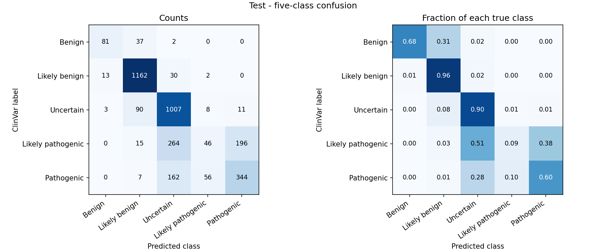
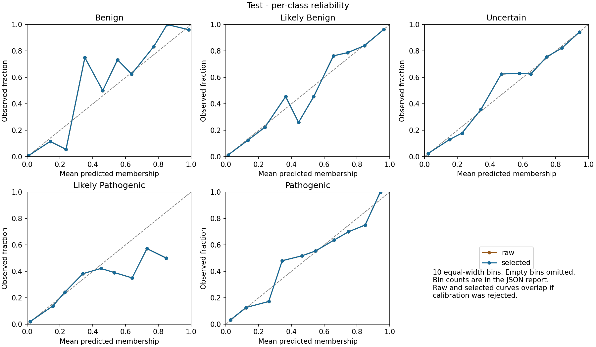
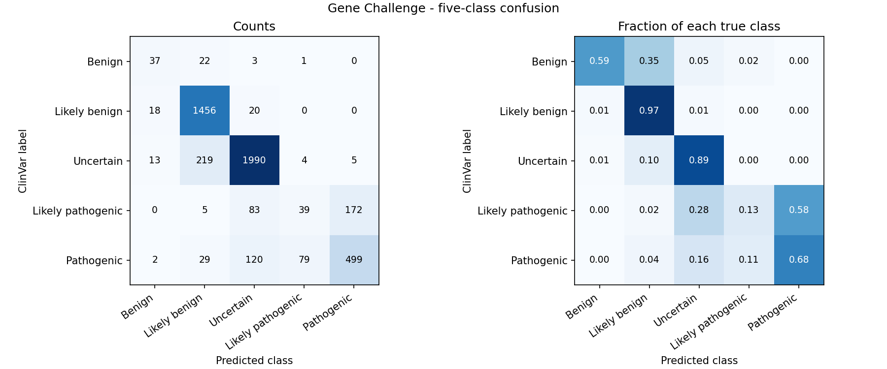
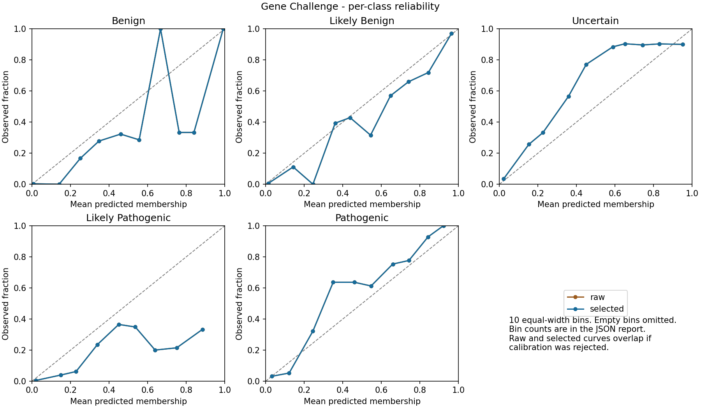

# Phase 5 held-out evaluation

Release status: **rejected_by_project_gates**.

These are the first scores on the reserved test and connected-gene challenge for this frozen split. Future changes cannot treat these sets as untouched.
Calibration: uncalibrated; temperature 1.000000. Low confidence is separate from the Uncertain class.

| Partition | Rows | Macro-F1 | Balanced accuracy | Log loss | Brier (0-2) | Mean class ECE |
|---|---:|---:|---:|---:|---:|---:|
| test | 3536 | 0.6417 | 0.6461 | 0.6560 | 0.3632 | 0.0106 |
| gene_challenge | 4816 | 0.6499 | 0.6538 | 0.5565 | 0.2871 | 0.0522 |

## test: per-class results

| Class | Precision | Recall | F1 | AP | Prevalence | Support |
|---|---:|---:|---:|---:|---:|---:|
| benign | 0.8351 | 0.6750 | 0.7465 | 0.7965 | 0.0339 | 120 |
| likely_benign | 0.8863 | 0.9627 | 0.9230 | 0.9512 | 0.3413 | 1207 |
| uncertain | 0.6874 | 0.8999 | 0.7794 | 0.7612 | 0.3165 | 1119 |
| likely_pathogenic | 0.4107 | 0.0883 | 0.1453 | 0.3544 | 0.1473 | 521 |
| pathogenic | 0.6243 | 0.6046 | 0.6143 | 0.6092 | 0.1609 | 569 |

Baseline macro-F1: dummy 0.1018; logistic 0.6246.
Standard-confidence coverage: 0.0%; accuracy within that subset: None.

Failed gates:
- recall_likely_pathogenic
- pathogenic_to_benign
- standard_coverage
- standard_accuracy

95% macro-F1 bootstrap interval: [0.5937, 0.6752]. Connected-gene cluster bootstrap; few clusters limit precision.

## gene_challenge: per-class results

| Class | Precision | Recall | F1 | AP | Prevalence | Support |
|---|---:|---:|---:|---:|---:|---:|
| benign | 0.5286 | 0.5873 | 0.5564 | 0.6396 | 0.0131 | 63 |
| likely_benign | 0.8411 | 0.9746 | 0.9029 | 0.9452 | 0.3102 | 1494 |
| uncertain | 0.8980 | 0.8920 | 0.8950 | 0.8877 | 0.4632 | 2231 |
| likely_pathogenic | 0.3171 | 0.1304 | 0.1848 | 0.2604 | 0.0621 | 299 |
| pathogenic | 0.7382 | 0.6845 | 0.7103 | 0.6955 | 0.1514 | 729 |

Baseline macro-F1: dummy 0.0947; logistic 0.6509.
Standard-confidence coverage: 0.0%; accuracy within that subset: None.

Failed gates:
- improvement_over_logistic
- recall_likely_pathogenic
- pathogenic_to_benign
- mean_class_ece
- standard_coverage
- standard_accuracy

95% macro-F1 bootstrap interval: [0.6246, 0.6737]. Canonical-variant bootstrap conditional on this one held-out gene component; not uncertainty across unseen genes.

## Interpretation and next steps

Temperature scaling preserves argmax and does not repair class separation. Review Likely pathogenic recall and its confusion with Uncertain/Pathogenic before any model release.
Acceptance gates use point estimates and are project criteria, not validated clinical standards. Bootstrap intervals do not account for model-selection uncertainty; the primary test has few gene clusters and the challenge contains only one connected gene group.
The JSON report contains raw/calibrated comparisons, confusion matrices, reliability bin counts, per-class AP (non-interpolated PR area), intervals, subgroup coverage, severe errors, and concrete misclassified variants.
Future model or feature changes require a new holdout or an explicitly documented reused-test study. Do not adjust these acceptance thresholds after seeing this report.
Low-confidence flags do not suppress or change five-class decisions. Calibration acceptance is validation-based and is separate from release acceptance.
