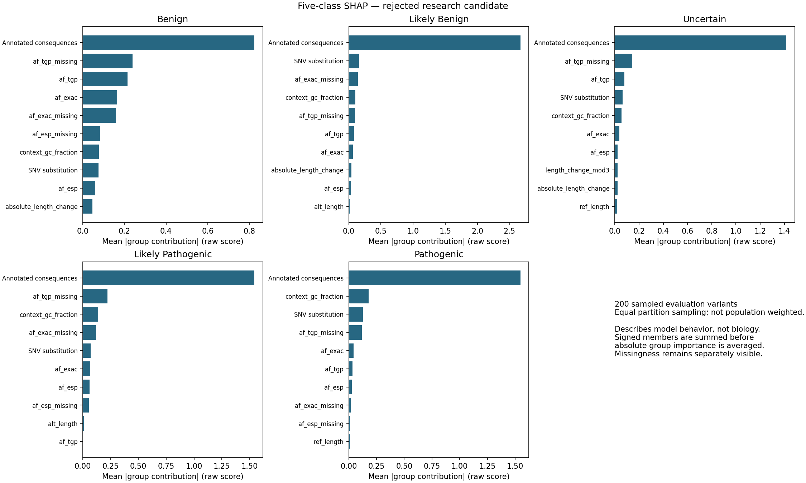
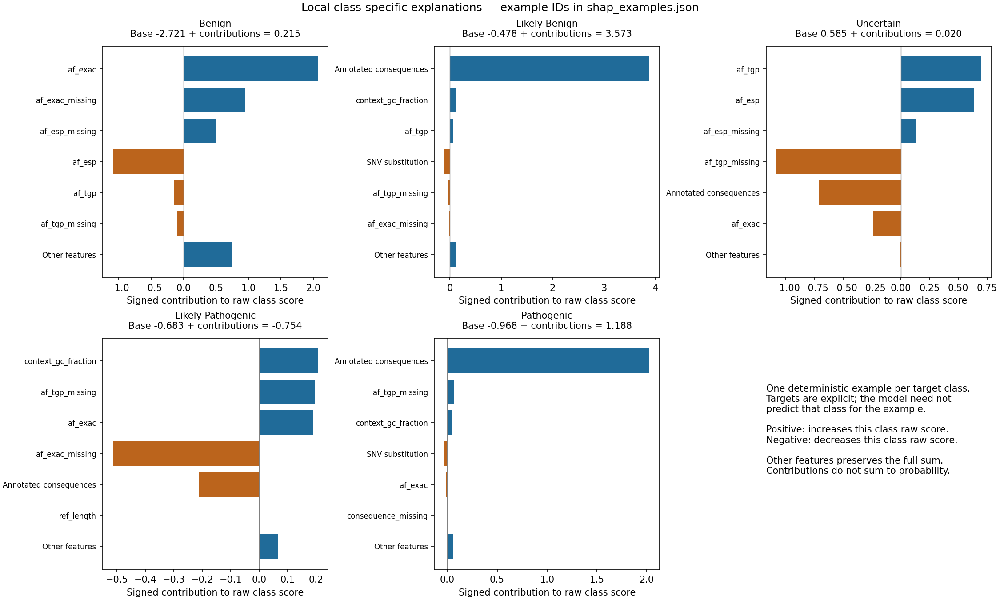

# Phase 6 SHAP assessment

**Status: explanation checks passed; model release still rejected.**

All five raw class margins were explained for 200 sampled evaluation variants (100 test, 100 gene challenge), using a frozen background of 100 training rows. These partitions were already evaluated in Phase 5; this is diagnostic reuse, not new accuracy evidence.

| Check | Result |
|---|---|
| Maximum absolute additivity error | 0.000005211 (tolerance 0.0001) |
| Class outputs checked | 1,000 (200 rows × five classes) |
| Persisted single/batch parity | Passed |
| Repeated build | Identical background, sample membership, SHAP arrays, margins, and local examples |
| Warm explanation p95 | 72.54 ms; passes 1,000 ms engineering budget |
| Automated suite | 55 ML tests passed |

Latency covers cached feature lookup, imputation, all-class SHAP, raw prediction, validation, and selected-class payload creation. Thirty timed calls followed three warmups on macOS 15.7.4 arm64. Startup, network, API, and concurrent application load are excluded. This is not an end-to-end service guarantee.

## Attribution review

Annotated consequences are the largest grouped mean absolute contribution for every class. The 1000 Genomes missingness indicator is second for Benign, Uncertain, and Likely pathogenic. These patterns warrant investigation of annotation-availability dependence; SHAP does not establish leakage or causality. Several indicators contribute to the consequence group, so comparing its total with a single numeric feature requires care.

Population missingness remains visible separately from frequencies. Grouped contributions sum signed members before taking absolute values for global averages; opposing contributions can cancel. The sample weights the two evaluation partitions equally, not by their prevalence or a clinical population.

## Global class summaries

## Local class-specific examples

The examples use the first sampled row with each reference label, with that class explicitly selected as the explanation target. That target need not be the predicted class. Full feature members, original/imputed values, identifiers, decisions, baseline, raw output, and signed contributions appear in [shap_examples.json](shap_examples.json). Positive contributions increase the named class output. Other features preserves the full displayed sum.

## Interpretation and provenance

Interventional Tree SHAP explains raw model margins relative to the training background. Contributions do not sum to class probabilities or patient disease risk. Correlated and constrained inputs can create unrealistic interventional combinations; explanations describe the fitted model, not biological mechanisms. Background choice and the small sample limit stability claims.

The model remains uncalibrated, all predictions remain flagged low confidence, and Phase 5 release failures remain unresolved. No API/UI integration or performance-threshold changes were made.

Artifacts: [manifest](shap_manifest.json), [numeric report](shap_report.json), and [ML README](../README.md). Full arrays, background, membership, and environment lock remain under ignored `ml/artifacts/shap-v1-final/`. Phase 5 predictions, policy, and access ledger checksums are unchanged. Both plots were visually reviewed.
